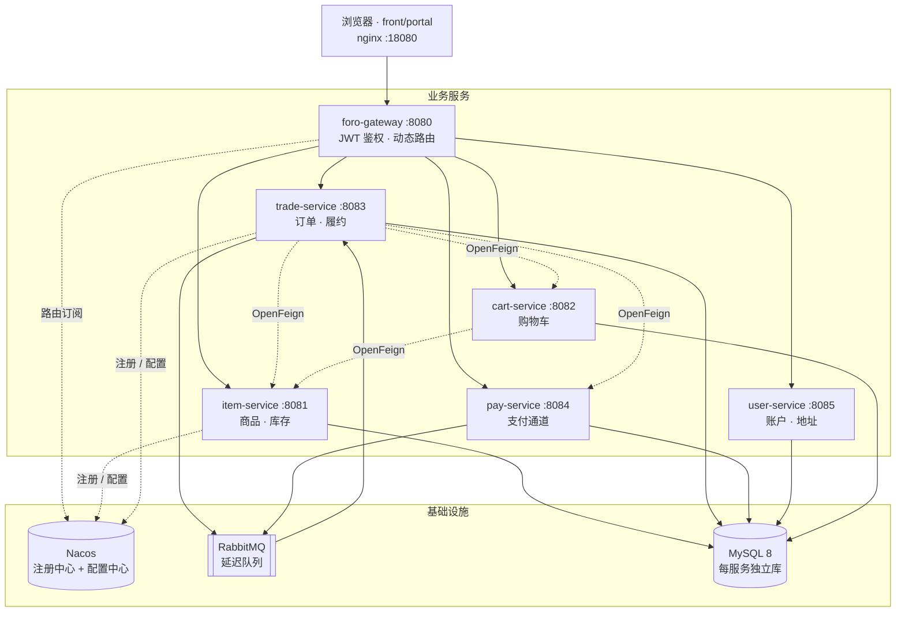
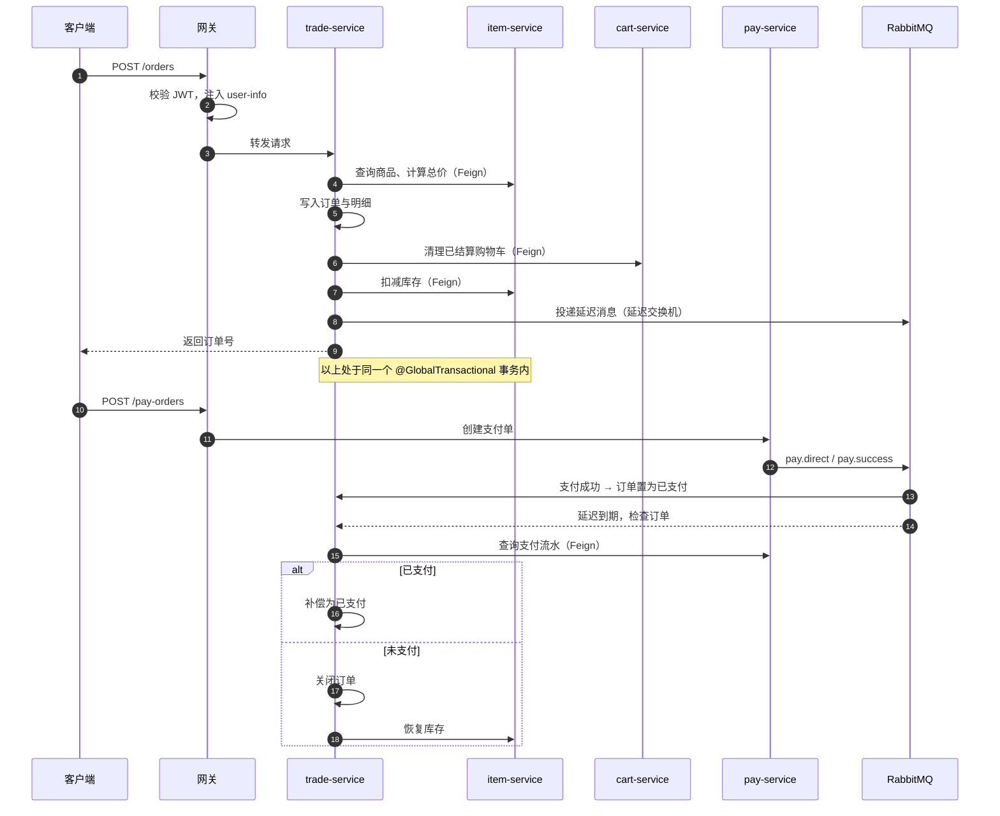

# 坊市 Foro

**一个基于 Spring Cloud Alibaba 的微服务电商交易平台。**

> 唐代长安设坊市：坊有墙、市有门，日中击鼓开市，日入击钲闭市。
> 本项目借这套制度组织代码——每个业务域是一坊，边界清晰、数据自治；网关是市门，统一鉴权与路由；交易是市，开闭有时序。

---

## 目录

- [项目简介](#项目简介)
- [系统架构](#系统架构)
- [模块职责](#模块职责)
- [技术栈](#技术栈)
- [核心链路](#核心链路)
- [数据模型](#数据模型)
- [关键设计](#关键设计)
- [快速开始](#快速开始)
- [目录结构](#目录结构)
- [后续演进](#后续演进)

---

## 项目简介

平台按电商交易域拆分为 6 个可独立部署的服务，配合 2 个公共模块，覆盖「商品浏览 → 加购 → 下单 → 支付 → 履约/关闭」的完整闭环。

仓库分为两部分：`backend/` 是 Spring Cloud Alibaba 微服务后端，`front/` 是三套可直接运行的静态站点（商城前台、商品管理、运营控制台）。前端不依赖构建工具，由 nginx 托管并反向代理到网关。

- **服务边界即数据边界**：每个服务独占一个数据库，跨库一致性由分布式事务保证，不共享表。
- **统一入口**：所有外部请求经网关，鉴权、路由、用户上下文透传在网关一层完成。
- **配置与注册集中管理**：服务发现与配置下发均由 Nacos 承担，配置支持热更新。
- **事件驱动**：订单超时关闭、支付成功通知通过 RabbitMQ 异步解耦，不依赖轮询。

## 系统架构



## 模块职责

| 模块 | 端口 | 职责 |
|---|---|---|
| `foro-gateway` | 8080 | 统一入口。JWT 校验、白名单放行、用户 ID 透传（`user-info` 请求头）、路由表从 Nacos 动态加载 |
| `item-service` | 8081 | 商品信息、分类与价格的多条件分页检索；库存查询与扣减 |
| `cart-service` | 8082 | 购物车增删改查，按用户维度隔离，下单后清理已结算条目 |
| `trade-service` | 8083 | 订单主表与明细、物流信息；创建订单、关闭订单、订单状态流转 |
| `pay-service` | 8084 | 支付单生成与状态维护，支持微信、支付宝、余额三类渠道；支付结果通过 MQ 回传交易服务 |
| `user-service` | 8085 | 登录签发 Token、用户信息、收货地址 |
| `foro-api` | — | 服务间调用的契约层：Feign 客户端、DTO、降级工厂 |
| `foro-common` | — | 公共能力：统一响应 `R`、分页对象、全局异常处理、用户上下文、MyBatis-Plus / MVC / MQ 配置 |

## 技术栈

### 接入层

| 技术 | 版本 | 用途 |
|---|---|---|
| Spring Cloud Gateway | 2021.0.3 | 统一网关，路由转发与全局过滤器 |
| Spring Security Crypto | — | 网关与用户服务共用 JWT 解析逻辑 |
| JJWT + RSA 密钥库 | `foro.jks` | 非对称签名，Token 有效期 30 分钟 |
| Knife4j（OpenAPI2） | — | 在线接口文档，各服务挂载在 `/doc.html` |

> 本仓库为后端服务集合，前端（Web / 移动端）不在其中；接口可直接通过 Knife4j 页面调试。

### 服务层

| 技术 | 版本 | 用途 |
|---|---|---|
| Spring Boot | 2.7.12 | 应用基座 |
| Spring Cloud | 2021.0.3 | 微服务治理能力 |
| Spring Cloud Alibaba | 2021.0.4.0 | Nacos / Sentinel / Seata 集成 |
| Spring Cloud OpenFeign | 随 Cloud | 声明式服务调用 |
| OkHttp | 随 Feign | Feign 底层 HTTP 客户端，替换默认实现 |
| Seata（AT 模式） | 随 SCA | `@GlobalTransactional` 跨服务事务 |

### 数据层

| 技术 | 版本 | 用途 |
|---|---|---|
| MySQL | 8.0.23 | 业务数据存储，每服务独立库 |
| MyBatis-Plus | 3.5.3.1 | ORM 与条件构造器，分页插件，逻辑删除与自动填充 |
| HikariCP | 随 Boot | 数据库连接池 |

### 中间件

| 中间件 | 用途 |
|---|---|
| **Nacos** | 服务注册发现；配置中心。各服务通过 `shared-configs` 共享 `shared-jdbc`、`shared-log`、`shared-swagger`、`shared-sentinel`、`shared-feign`、`shared-seata`、`shared-amqp` 等配置；网关额外订阅 `gateway-routes.json` 实现路由热更新 |
| **RabbitMQ** | 消息驱动。延迟交换机 `trade.delay.direct` 处理订单超时关闭；`pay.direct` 广播支付成功事件；消息体统一 Jackson JSON 序列化 |
| **Sentinel** | 流量防护。规则集中在 Nacos 共享配置中下发，业务代码零侵入 |
| **Seata** | 分布式事务协调，覆盖下单扣库存、支付记账等跨库操作 |

### 工程化

| 技术 | 用途 |
|---|---|
| JDK 11 / Maven | 编译与多模块构建 |
| Lombok | 消除样板代码 |
| Hutool 5.8.11 | 字符串、集合、JSON 等工具 |
| Logback | 日志输出，按服务名分目录落盘 |

## 核心链路

从下单到关单，是这套架构里最能说明问题的一条链路：



## 数据模型

各服务独立建库，无跨库 JOIN。

| 数据库 | 核心表 |
|---|---|
| `foro-item` | `item`（商品：名称、价格、品牌、分类、库存、状态） |
| `foro-cart` | `cart`（用户、商品、数量、价格快照） |
| `foro-trade` | `order`、`order_detail`、`order_logistics` |
| `foro-pay` | `pay_order`（业务订单号、支付渠道、金额、状态） |
| `foro-user` | `user`、`address` |

订单状态：`1` 待支付、`2` 已支付、`5` 已关闭。

## 关键设计

**1. 网关统一鉴权与身份透传**
网关用公钥验签 JWT，解析出用户 ID 后写入 `user-info` 请求头，下游服务不再重复解析 Token；`foro-common` 的拦截器把该头部写入 `UserContext`（ThreadLocal），业务层直接读取当前用户。白名单（搜索、登录、商品详情、文档）在配置中维护，无需改代码。

**2. 路由表动态化**
路由不写死在 `application.yaml`，而是由 `DynamicRouteLoader` 监听 Nacos 的 `gateway-routes.json`，变更时增量重建 `RouteDefinition`，无需重启网关。

**3. 分布式事务**
下单涉及订单库、库存、购物车三处写入，用 Seata AT 模式的 `@GlobalTransactional` 包裹，任一环节失败整体回滚；本地单库操作则使用 `@Transactional` 即可，避免无谓的全局事务开销。

**4. 延迟队列关单，而非定时扫表**
订单创建后投递一条延迟消息，到期后回查支付流水：已支付则补偿状态，未支付则关单并恢复库存。相比定时任务全表扫描，时效性更好、数据库压力更小。当前延迟时长设为 10 秒便于演示，生产环境对应 30 分钟。

**5. 降级与容错**
Feign 客户端通过 `fallbackFactory` 提供降级实现，下游异常时返回兜底数据而不阻断主链路；商品、支付的降级逻辑各自独立。

**6. 统一契约**
`foro-api` 只放 Feign 接口与 DTO，服务间不暴露实体类；`foro-common` 提供 `R`、`PageDTO` 与全局异常处理，所有接口的错误码与响应结构保持一致。

## 快速开始

### 环境要求

| 组件 | 版本 |
|---|---|
| JDK | 11 |
| Maven | 3.6+ |
| MySQL | 8.0+ |
| RabbitMQ | 3.9+（需启用 `rabbitmq_delayed_message_exchange` 插件） |
| Nacos | 2.x |

### 启动步骤

**后端（`backend/`）**

1. **初始化数据库**：创建 5 个库（`foro-item`、`foro-cart`、`foro-trade`、`foro-pay`、`foro-user`）并导入建表脚本。
2. **配置 Nacos**：在 `DEFAULT_GROUP` 下建立共享配置（数据源、日志、Swagger、Sentinel、Feign、Seata、RabbitMQ 连接）与 `gateway-routes.json` 路由表。
3. **修改注册中心地址**：各服务 `bootstrap.yml` 中的 `spring.cloud.nacos.server-addr` 指向自己的 Nacos 实例。
4. **按顺序启动**：在 `backend/` 目录下执行 `mvn -pl foro-common,foro-api -am install` 后启动各服务，`foro-gateway` 最后启动；网关启动时会拉取已注册的服务列表。
5. **验证**：访问 `http://localhost:8080/doc.html` 查看聚合文档，或直接调用 `http://localhost:8080/search/list?key=手机`。

**前端（`front/`）**

1. 把 `front/nginx.conf` 复制到 nginx 的 `conf/` 目录，将其中的 `__FRONT_DIR__` 替换为 `front/` 的绝对路径（如 `D:/JavaWebCode/foro/front`）。
2. 启动 nginx，访问下列站点：

| 站点 | 地址 | 目录 |
|---|---|---|
| 商城前台 | `http://localhost:18080` | `front/portal` |
| 商品与用户管理 | `http://localhost:18081` | `front/admin` |
| 运营控制台 | `http://localhost:18082` | `front/console` |

3. 页面所有请求走 `/api/**`，由 nginx 去掉前缀转发到 `localhost:8080`（即网关），因此后端未启动时页面可以打开但数据为空。

> 网关的 JWT 密钥库随仓库提供（`foro-gateway/src/main/resources/foro.jks`），仅供本地演示使用；部署到生产环境请替换为自有密钥并通过环境变量注入口令。

## 目录结构

```
foro/
├── front/                        # 前端：三套静态站点，无需构建
│   ├── portal/                   # 商城前台：首页 / 搜索 / 购物车 / 下单 / 支付
│   ├── admin/                    # 商品与用户管理
│   ├── console/                  # 运营控制台（含 ECharts 看板）
│   ├── nginx.conf                # 三站点托管 + /api 反向代理
│   └── README.md                 # 前端说明
├── backend/                      # 后端微服务
│   ├── pom.xml                   # 聚合 POM，统一版本管理
│   ├── foro-gateway/             # 网关：鉴权、路由、跨域
│   │   └── src/main/java/com/foro/gateway/
│   │       ├── filters/          # AuthGlobalFilter 全局鉴权
│   │       ├── routers/          # DynamicRouteLoader 动态路由
│   │       └── config/           # JWT / 白名单配置
│   ├── item-service/             # 商品服务
│   ├── cart-service/             # 购物车服务
│   ├── trade-service/            # 交易服务（延迟关单、支付回调）
│   ├── pay-service/              # 支付服务
│   ├── user-service/             # 用户服务
│   ├── foro-api/                 # Feign 客户端 + DTO + 降级工厂
│   └── foro-common/              # 统一响应、异常、拦截器、MyBatis/MQ 配置
└── README.md
```

## 后续演进

- [ ] 商品检索由 MySQL 多条件分页迁移到 Elasticsearch，支持分词与相关性排序
- [ ] 引入 Redis 缓存商品详情与购物车热点数据，降低数据库读压力
- [ ] 支付服务对接真实渠道 SDK，补齐对账与退款流程
- [ ] 补充链路追踪（Micrometer Tracing）与统一监控看板
- [ ] 增加 Docker Compose / K8s 部署编排

---

如果这个项目对你有帮助，欢迎 Star。
